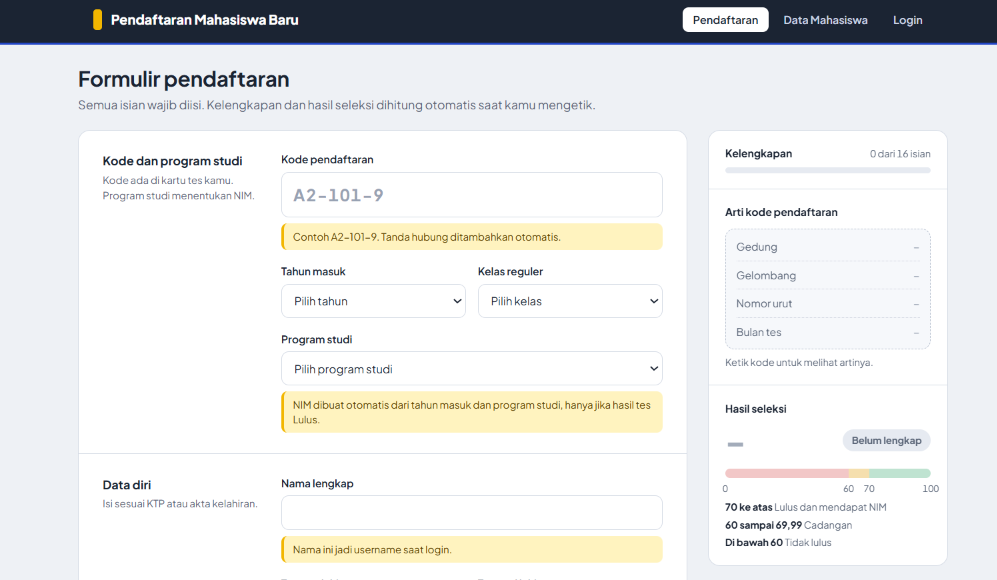
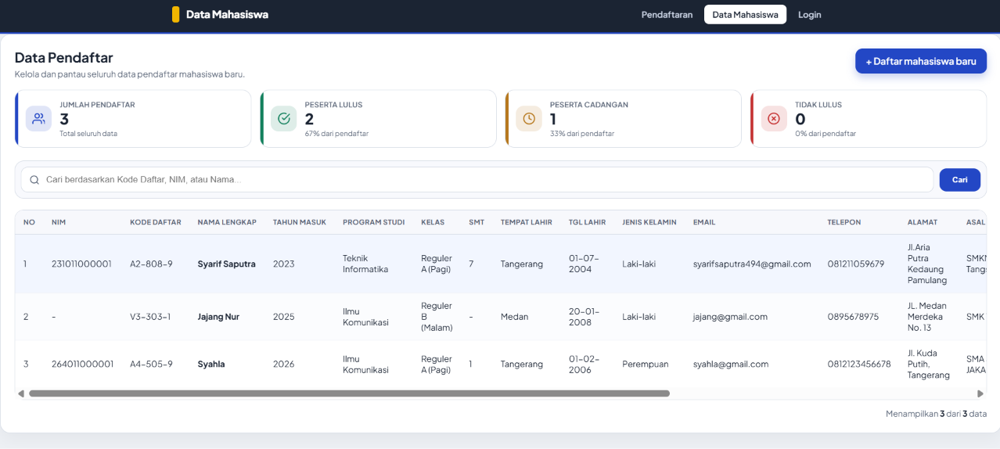
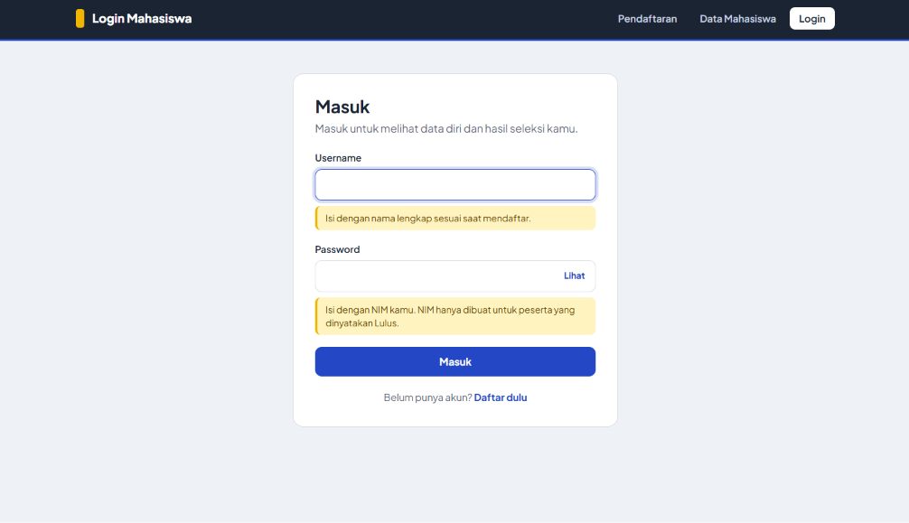
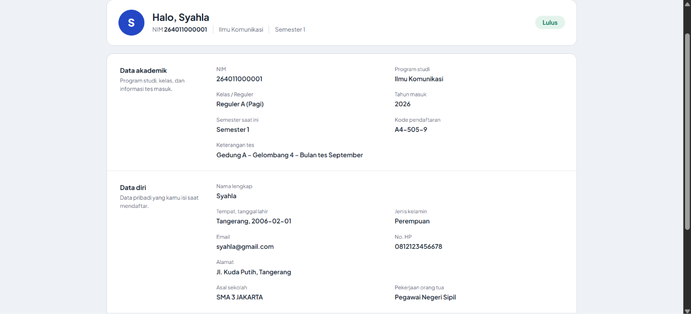

# Sistem Pendaftaran Mahasiswa Baru UTS 

Aplikasi web pendaftaran mahasiswa baru berbasis **PHP native** ini adalah Tugas UTS Saya Dan Dari Dosen Memerintahkan untuk Mencoba tanpa framework dan tanpa database. Data disimpan di session dan dicadangkan ke file JSON. Proyek ini dibuat untuk tugas UTS matakuliah **Pemrograman Web II**, Teknik Informatika, Universitas Pamulang.

## Tampilan

| Pendaftaran | Data Mahasiswa |
|---|---|
|  |  |

| Login | Dashboard Mahasiswa |
|---|---|
|  |  |

## Fitur

- **Form pendaftaran** dengan validasi: semua isian wajib diisi, format email dan nomor HP, serta pengecekan nama dan kode yang kembar.
- **Kode pendaftaran** dengan format `[Gedung][Gelombang]-[3 angka]-[Bulan tes]`. Artinya langsung tampil saat kode diketik.
- **Hasil seleksi otomatis** dari rata-rata tiga nilai tes. Rata-rata tampil langsung di samping form lewat meter.
- **NIM 12 digit otomatis** dari tahun masuk dan kode program studi, hanya untuk peserta yang Lulus.
- **Login mahasiswa**: username memakai nama lengkap, password memakai NIM.
- **Dashboard mahasiswa** berisi data akademik, data diri, nilai tes, dan semester yang dihitung otomatis dari tahun masuk.
- **Data mahasiswa** dengan kartu ringkasan, pencarian (kode daftar, NIM, nama), dan tombol edit.
- **Edit dan hapus data** langsung dari form.
- **Sinkronisasi dengan file JSON**: perubahan manual di `data_mahasiswa.json` langsung terlihat di semua halaman.

## Aturan seleksi

| Rata-rata nilai | Hasil | NIM |
|---|---|---|
| 70 ke atas | Lulus | Dibuat otomatis |
| 60 sampai 69,99 | Cadangan | Belum dibuat |
| Di bawah 60 | Tidak lulus | Tidak dibuat |

Nilai yang dihitung: Matematika, Bahasa Inggris, dan Pelajaran Umum.

## Aturan kode pendaftaran

Format: `[Gedung][Gelombang]-[3 angka]-[Bulan tes]`

- **Gedung:** `A` = Gedung A, `B` = Gedung B, `V` = Gedung Viktor
- **Gelombang:** angka 1 sampai 9
- **Bulan tes:** 1 sampai 9 = Januari sampai September, `A` = Oktober, `B` = November, `C` = Desember

Contoh: `A2-101-9` berarti Gedung A, Gelombang 2, bulan September.

## Teknologi

- PHP 8 (native, tanpa framework)
- HTML, CSS, dan JavaScript murni
- Penyimpanan: session PHP dan file JSON

## Cara menjalankan

Syarat: PHP 8.0 atau lebih baru.

**Pakai Laragon atau XAMPP**

1. Clone repositori ke folder web server (`C:\laragon\www` atau `C:\xampp\htdocs`).
   ```bash
   git clone https://github.com/USERNAME/NAMA-REPO.git
   ```
2. Jalankan Apache dari Laragon atau XAMPP.
3. Buka `http://localhost/NAMA-REPO/` (di Laragon bisa juga lewat `http://NAMA-REPO.test`).

**Pakai server bawaan PHP**

```bash
git clone https://github.com/USERNAME/NAMA-REPO.git
cd NAMA-REPO
php -S localhost:8000
```

Lalu buka `http://localhost:8000`.

**Data contoh (opsional)**

File `data_mahasiswa.json` dibuat otomatis saat ada pendaftar pertama dan tidak ikut di repositori karena berisi data pribadi. Untuk mencoba dengan data contoh, salin file contohnya:

```bash
cp data_mahasiswa.example.json data_mahasiswa.json
```

Di Windows (Command Prompt): `copy data_mahasiswa.example.json data_mahasiswa.json`

Peserta contoh yang Lulus akan otomatis mendapat NIM saat halaman dibuka. NIM-nya bisa dilihat di halaman **Data Mahasiswa**.

## Cara login

1. Daftar lewat halaman **Pendaftaran**. Jika hasilnya Lulus, NIM tampil di pesan setelah mendaftar.
2. Buka halaman **Login**.
3. Username diisi nama lengkap, password diisi NIM.

## Struktur folder

```
.
├── index.php                      # Form pendaftaran, tambah dan edit
├── data.php                       # Daftar pendaftar, ringkasan, pencarian
├── login.php                      # Halaman login
├── dashboard.php                  # Dashboard mahasiswa setelah login
├── logout.php                     # Keluar dari akun
├── config.php                     # Session, fungsi bantu, aturan seleksi dan kode
├── style.css                      # Gaya dasar
├── data_mahasiswa.example.json    # Contoh data
└── docs/screenshots/              # Gambar untuk README
```

## Catatan

- Proyek ini untuk keperluan belajar. Data disimpan di file JSON, bukan database, jadi tidak cocok untuk produksi.
- Password disimpan dalam bentuk hash (`password_hash`).
- `data_mahasiswa.json` masuk `.gitignore` agar data pendaftar tidak ikut terunggah.

## Pembuat

Syarif, Teknik Informatika, Universitas Pamulang.
